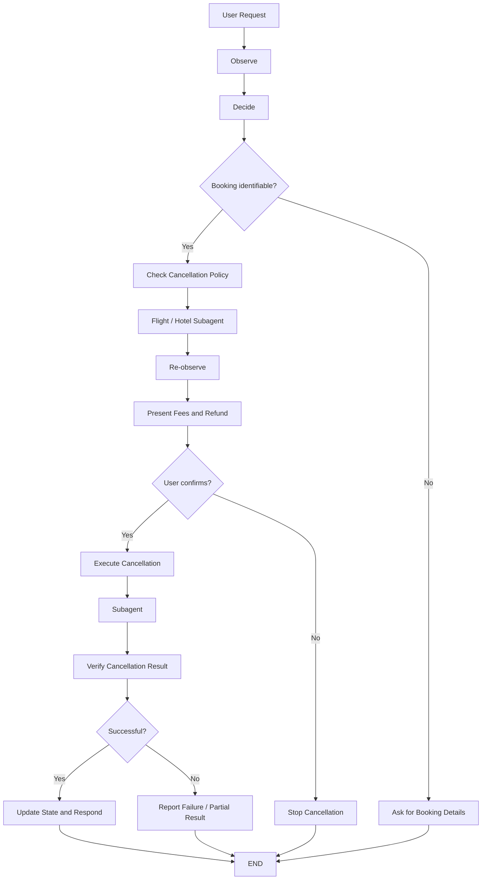
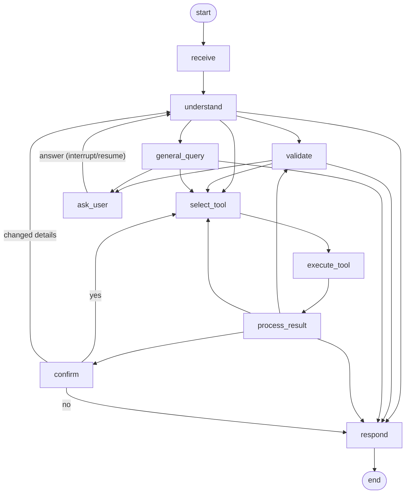
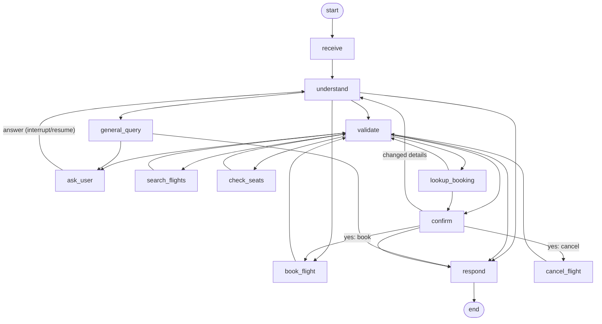

# Mock Travel APIs (Hotel + Flight)

## LangGraph supervisor

The travel supervisor is available as `travel_agent.orchestrator.Orchestrator`. It uses the existing
`HotelAgent.run_task` and `FlightAgent.run_task` interfaces and never calls either Mock API itself.
The adapter maps their different result models to a common status/data/error response. A request naming
both domains fans out to the two agents concurrently; results are then combined without claiming success
unless the agents returned it. Ambiguous booking or cancellation requests receive a domain clarification.

### Shared FAQ and policy retrieval

The supervisor runs a shared FAISS retrieval step before routing. FAQ and general hotel/flight policy
questions are answered from the indexed mock knowledge base without invoking a booking subagent.
Hotel and flight rules and cancellation terms are indexed per entity read from the mock API databases;
the generated sample policies are illustrative and can differ by hotel, flight, or fare. For bookings,
lookups, enquiries, and cancellation actions, the supervisor still calls the relevant subagent and
forwards matching retrieved context in its task.
Follow-up policy questions reuse the last retrieved match in the same conversation. Refund eligibility
is not inferred from policy text alone; when booking dates or rate/fare details are missing, the assistant
states the relevant conditions and asks for the information needed to check.

The index is built once per process from `data/hotel.db` and `data/flight.db` (or the configured mock
database paths); seed data is used if a database has not been initialized yet. `faiss-cpu` is installed
through `requirements.txt`.

### ReAct architecture implemented

This project follows the ReAct cancellation flow shown in the architecture image:



The active implementation is the supervisor in `travel_agent/orchestrator/graph.py`, with the ReAct state in `travel_agent/orchestrator/state.py` and the routing prompt in `travel_agent/prompts/orchestrator.md`.

Each supervisor conversation needs a stable `thread_id`. It checkpoints routing history and pending
domains, and gives each subagent a separate `{thread_id}:hotel` or `{thread_id}:flight` thread so its
own graph can resume questions and confirmations. The default checkpointing is in-memory. For restart
survival, build the hotel and flight agents with persistent checkpointers and pass a persistent
checkpointer to `Orchestrator` as well.

```python
from travel_agent.orchestrator import Orchestrator

travel = Orchestrator()
answer = travel.chat("Find flights from Bangalore to Mumbai", thread_id="trip-123")
print(answer["final_response"])
```

Run both Mock APIs first with `python -m mock_apis.run_mocks`, then run your application using the
supervisor. Orchestrator routing tests use controlled subagent doubles and do not need the APIs.

For an interactive terminal conversation, start the Mock APIs and run:

```bash
python -m travel_agent.orchestrator
```

Use `--no-llm` to use rule-based understanding, `--thread trip-123` to resume a saved conversation,
or `--debug` to show error logs. Type `quit` or `exit` to leave the chat. The assistant keeps the
same thread for each turn and relays follow-up questions from the selected subagent.

Two independent FastAPI + SQLite services that simulate real booking backends. They contain no LangGraph or LLM code; future Hotel and Flight subagents will call them over plain REST.

| Service | Port | Swagger UI | Database |
|---|---|---|---|
| Hotel API | 8001 | http://localhost:8001/docs | `data/hotel.db` |
| Flight API | 8002 | http://localhost:8002/docs | `data/flight.db` |

## Layout

```
mock_apis/
├── common/            # shared helpers only: SQLite + transactions, error/response envelopes, IDs
├── hotel_api/
│   ├── app.py         # FastAPI app factory (lifespan initialises + seeds the DB)
│   ├── routes.py      # HTTP layer only
│   ├── schemas.py     # request/response models (pydantic)
│   ├── service.py     # business rules, pricing, transactions
│   ├── repository.py  # SQL statements
│   ├── models.py      # table DDL + row dataclasses
│   ├── database.py    # connection dependency, schema creation
│   ├── seed.py        # dummy data + `python -m` init/seed CLI
│   └── config.py
├── flight_api/        # same layout
└── run_mocks.py       # starts both services
tests/hotel_api/  tests/flight_api/   # separate pytest suites
```

## Install

```bash
python -m venv .venv && source .venv/bin/activate   # skip if .venv exists
pip install -r requirements.txt
```

## Initialise and seed the databases

The services create the schema and seed data automatically on startup (idempotent; existing bookings and inventory are never overwritten). To do it by hand:

```bash
python -m mock_apis.hotel_api.seed            # create + seed (safe to re-run)
python -m mock_apis.flight_api.seed
python -m mock_apis.hotel_api.seed --reset    # delete the DB file and start fresh
python -m mock_apis.flight_api.seed --reset
```

Seed data: 14 hotels in Bangalore, Mumbai, Delhi, Hyderabad, Chennai and Pune; 18 daily one-way flights on Bangalore-Mumbai, Bangalore-Delhi, Delhi-Mumbai, Mumbai-Chennai, Hyderabad-Bangalore, Chennai-Delhi (plus a few return legs) across IndiGo, Air India, Akasa Air and SpiceJet. Inventory (rooms per night, seats per date) is created for today plus 365 days and topped up on every start.

Override paths with `HOTEL_DB_PATH` / `FLIGHT_DB_PATH`.

## Run

Independently:

```bash
python -m mock_apis.hotel_api     # http://localhost:8001
python -m mock_apis.flight_api    # http://localhost:8002
# or: uvicorn mock_apis.hotel_api.app:app --port 8001
```

Both together (Ctrl+C stops both):

```bash
python -m mock_apis.run_mocks            # or scripts/run_mocks.sh
python -m mock_apis.run_mocks --only hotel
```

## Tests

```bash
pytest                    # everything
pytest tests/hotel_api    # hotel only
pytest tests/flight_api   # flight only
```

Each test uses its own temporary SQLite file.

## Response format (both APIs)

Success:

```json
{ "success": true, "message": "Hotel booked successfully.", "data": { } }
```

Failure:

```json
{ "success": false, "error": { "code": "ROOMS_UNAVAILABLE", "message": "...", "details": { } } }
```

| HTTP | Code | When |
|---|---|---|
| 200 | | search, get, cancel, idempotent replay |
| 201 | | booking created |
| 404 | `HOTEL_NOT_FOUND`, `FLIGHT_NOT_FOUND`, `BOOKING_NOT_FOUND`, `NOT_FOUND` | unknown resource |
| 409 | `ROOMS_UNAVAILABLE`, `SEATS_UNAVAILABLE` | not enough inventory |
| 409 | `BOOKING_ALREADY_CANCELLED` | repeat cancellation (inventory is not restored again) |
| 409 | `IDEMPOTENCY_KEY_CONFLICT` | key reused with a different request body |
| 422 | `VALIDATION_ERROR` | malformed input (`details` lists `field` + `message`) |
| 422 | `INVALID_DATE`, `CAPACITY_EXCEEDED`, `FLIGHT_DEPARTED` | business-rule validation |
| 500 | `INTERNAL_ERROR` | unexpected failure |

## Safeguards

- **Transactions:** every booking and cancellation runs in `BEGIN IMMEDIATE`, so concurrent writers are serialised before inventory is read. Stock updates are also guarded (`... WHERE available >= n`) and the columns carry `CHECK (available >= 0)`.
- **Idempotency:** send an `Idempotency-Key` header (8-128 chars) on `POST /api/v1/bookings`. A retry with the same key and body returns the original booking with HTTP 200; the same key with a different body returns 409.
- **Cancellation:** status changes `CONFIRMED -> CANCELLED` with a conditional update, and inventory is restored only if that update succeeded. Restores are capped at total capacity. No cancellation fees in this version.
- **Server-side pricing:** price fields in a request are rejected (422). Hotel total = price per night x nights x rooms; flight total = fare x passengers.
- **Validation:** past dates, stays over 30 nights, more than 5 rooms / 9 passengers, guests above room capacity, flights that already departed, malformed email/phone.

## Hotel API

| Method | Path | Purpose |
|---|---|---|
| GET | `/api/v1/hotels/search` | availability for a stay |
| GET | `/api/v1/hotels/{hotel_id}` | hotel details |
| POST | `/api/v1/bookings` | book (optional `Idempotency-Key`) |
| GET | `/api/v1/bookings/{booking_id}` | booking details |
| POST | `/api/v1/bookings/{booking_id}/cancel` | cancel |
| GET | `/health` | liveness |

Search query params: `city`, `check_in`, `check_out`, `guests` (default 1), `rooms` (default 1), optional `min_rating`, `max_price_per_night`. A hotel is returned only if it has enough rooms on **every** night and the guests fit (`guests <= rooms x max_guests_per_room`).

```bash
curl "localhost:8001/api/v1/hotels/search?city=Bangalore&check_in=2026-12-10&check_out=2026-12-12&guests=2&rooms=1"
```

```json
{
  "success": true,
  "message": "Found 3 hotel(s) in Bangalore.",
  "data": {
    "city": "Bangalore", "check_in": "2026-12-10", "check_out": "2026-12-12",
    "nights": 2, "guests": 2, "rooms": 1, "count": 3,
    "hotels": [{
      "hotel_id": "HT-1003", "name": "Whitefield Business Inn", "city": "Bangalore",
      "locality": "Whitefield", "address": "5 ITPL Main Road, Whitefield, Bengaluru 560066",
      "rating": 3.9, "star_category": 3, "price_per_night": 3400, "currency": "INR",
      "total_rooms": 25, "max_guests_per_room": 2, "amenities": ["WiFi", "Breakfast", "Parking"],
      "rooms_available": 25, "nights": 2, "rooms_requested": 1, "estimated_total_price": 6800
    }]
  }
}
```

Book:

```bash
curl -X POST localhost:8001/api/v1/bookings \
  -H "Content-Type: application/json" -H "Idempotency-Key: asha-trip-0001" \
  -d '{"hotel_id":"HT-1001","check_in":"2026-12-10","check_out":"2026-12-12","rooms":1,"guests":2,
       "guest":{"name":"Asha Rao","email":"asha@example.com","phone":"+919876543210"}}'
```

```json
{
  "success": true,
  "message": "Hotel booked successfully.",
  "data": {
    "booking_id": "HB-0B625412DC", "status": "CONFIRMED",
    "hotel": {"hotel_id": "HT-1001", "name": "Lakeview Grand Bengaluru", "city": "Bangalore", "locality": "MG Road", "rating": 4.5},
    "check_in": "2026-12-10", "check_out": "2026-12-12", "nights": 2, "rooms": 1, "guests": 2,
    "price_per_night": 9500, "total_price": 19000, "currency": "INR",
    "guest": {"name": "Asha Rao", "email": "asha@example.com", "phone": "+919876543210"},
    "created_at": "2026-11-02T11:35:55+00:00", "cancelled_at": null
  }
}
```

Cancel (`status` becomes `CANCELLED`, rooms return to inventory; a second call returns 409):

```bash
curl -X POST localhost:8001/api/v1/bookings/HB-0B625412DC/cancel
```

Sold out:

```json
{ "success": false,
  "error": { "code": "ROOMS_UNAVAILABLE", "message": "Not enough rooms at Lakeview Grand Bengaluru for the whole stay.",
             "details": { "rooms_requested": 1, "rooms_available": 0 } } }
```

## Flight API

| Method | Path | Purpose |
|---|---|---|
| GET | `/api/v1/flights/search` | one-way availability |
| POST | `/api/v1/bookings` | book (optional `Idempotency-Key`) |
| GET | `/api/v1/bookings/{booking_id}` | booking details |
| POST | `/api/v1/bookings/{booking_id}/cancel` | cancel |
| GET | `/health` | liveness |

Flights are daily schedules. Search returns a `flight_id` and a `departure_date`; booking takes both because seats are tracked per date. Times are local (IST). Each passenger takes one seat and pays the full fare.

```bash
curl "localhost:8002/api/v1/flights/search?origin=Bangalore&destination=Mumbai&departure_date=2026-12-10&passengers=2"
```

`origin` / `destination` accept a city name or IATA code (`BLR`, `BOM`, `DEL`, `HYD`, `MAA`), case-insensitive.

```json
{
  "success": true,
  "message": "Found 3 flight(s) from Bangalore to Mumbai.",
  "data": {
    "origin": "Bangalore", "destination": "Mumbai", "departure_date": "2026-12-10", "passengers": 2, "count": 3,
    "flights": [{
      "flight_id": "FL-1001", "airline": "IndiGo", "airline_code": "6E", "flight_number": "6E-501",
      "aircraft": "Airbus A320neo",
      "origin": {"city": "Bangalore", "code": "BLR"}, "destination": {"city": "Mumbai", "code": "BOM"},
      "departure_date": "2026-12-10", "departure_time": "2026-12-10T06:15:00", "arrival_time": "2026-12-10T08:00:00",
      "duration_minutes": 105, "price_per_passenger": 4800, "total_price": 9600, "currency": "INR",
      "seats_available": 180
    }]
  }
}
```

Book:

```bash
curl -X POST localhost:8002/api/v1/bookings \
  -H "Content-Type: application/json" -H "Idempotency-Key: asha-flight-0001" \
  -d '{"flight_id":"FL-1001","departure_date":"2026-12-10",
       "passengers":[{"name":"Asha Rao","age":31,"gender":"FEMALE"},{"name":"Vikram Rao","age":34,"gender":"MALE"}],
       "contact":{"email":"asha@example.com","phone":"+919876543210"}}'
```

```json
{
  "success": true,
  "message": "Flight booked successfully.",
  "data": {
    "booking_id": "FB-2290B48E8B", "status": "CONFIRMED",
    "flight": {"flight_id": "FL-1001", "airline": "IndiGo", "flight_number": "6E-501",
               "origin": {"city": "Bangalore", "code": "BLR"}, "destination": {"city": "Mumbai", "code": "BOM"},
               "departure_time": "2026-12-10T06:15:00", "arrival_time": "2026-12-10T08:00:00"},
    "departure_date": "2026-12-10", "num_passengers": 2,
    "passengers": [{"name": "Asha Rao", "age": 31, "gender": "FEMALE"}, {"name": "Vikram Rao", "age": 34, "gender": "MALE"}],
    "price_per_passenger": 4800, "total_price": 9600, "currency": "INR",
    "contact": {"email": "asha@example.com", "phone": "+919876543210"},
    "created_at": "2026-11-02T11:35:55+00:00", "cancelled_at": null
  }
}
```

Cancel (seats return to inventory once; repeat calls return 409 `BOOKING_ALREADY_CANCELLED`):

```bash
curl -X POST localhost:8002/api/v1/bookings/FB-2290B48E8B/cancel
```

Not enough seats:

```json
{ "success": false,
  "error": { "code": "SEATS_UNAVAILABLE", "message": "Only 1 seat(s) left on TA-1 for 2026-12-10.",
             "details": { "seats_requested": 2, "seats_available": 1 } } }
```

## Notes for agent integration

- Both services use `/api/v1/bookings` for booking and `/api/v1/bookings/{id}/cancel`, so the Hotel Agent and Flight Agent tools can share one pattern. Booking IDs are prefixed `HB-` (hotel) and `FB-` (flight).
- Generate one `Idempotency-Key` per booking intent and reuse it on retries.
- Branch on `success`, then on `error.code`; messages are written to be shown or paraphrased to the user.

---

# Hotel Agent (LangGraph subagent)

Code lives in `travel_agent/hotel_agent/`. It talks only to the Hotel API (port 8001). The Orchestrator and the Flight Agent are not implemented.

## Run

```bash
source .venv/bin/activate
scripts/run_mocks.sh --only hotel      # terminal 1: Hotel API on :8001
scripts/run_hotel_agent.sh             # terminal 2: chat (add --verbose to see nodes, --no-llm for rules only)
python scripts/demo_hotel_agent.py     # scripted multi-turn demo with the real model
pytest                                 # API tests + agent tests (no model, no network needed)
```

Type `quit` or `exit` (or press Ctrl+C) to leave. `--thread ID` resumes a saved conversation (SQLite checkpoints in `data/checkpoints.db`).

## What it does

| Intent | Tools used | Confirmation |
|---|---|---|
| Availability and budget search | `check_hotel_availability` | no |
| Hotel details, compare, general questions | `get_hotel_details` | no |
| Booking | `check_hotel_availability` (pre-check), `get_hotel_details`, `book_hotel` | yes, always |
| Booking status | `get_booking_status` | no |
| Cancellation | `get_booking_status`, `cancel_hotel_booking` | yes, always |

## Workflow

The compiled graph is saved to `artifacts/hotel_agent_graph.{png,mmd,txt}` every time the agent is built.



## Accuracy rules (no hallucination)

- Every hotel name, price, rating, amenity, date, booking ID and status shown to the user is rendered by templates from API data. The model never writes facts.
- The LLM only labels the intent and copies city / hotel / guest names. Each copied name must appear in the user's text, and implausible labels (for example CANCEL without the word "cancel") are discarded. If the model fails or is unsure, keyword rules take over.
- Dates, numbers, IDs, emails and phones are parsed by code. A past date, a check-out before check-in, a bad email or a bad phone is never sent to the API.
- Booking and cancelling run only after an explicit yes. Unclear replies are not consent, and changing a detail re-shows the summary.
- Booking uses an `Idempotency-Key`; if a request times out after sending, the agent retries with the same key (no double booking) or says the outcome is unverified. A timed-out cancel is checked with a status lookup, never guessed.
- API failures become short friendly messages ("Nothing was changed. Please try again."), never stack traces.

## Orchestrator interface

```python
from travel_agent.hotel_agent import HotelAgent, HotelTask, Intent

agent = HotelAgent()
result = agent.run_task(HotelTask(
    message="find hotels", thread_id="user-42", intent=Intent.CHECK_AVAILABILITY,
    params={"city": "Pune", "check_in": "2026-12-02", "check_out": "2026-12-04", "guests": 2},
))
result.status        # completed | needs_input | needs_confirmation | failed | unverified | declined
result.message       # text to show the user
result.missing_params, result.question, result.data, result.error
```

When `status` is `needs_input` or `needs_confirmation`, send the user's next message with the same `thread_id`; the paused graph resumes with it.

## Model

`~/models/qwen2.5-3b-q4km.gguf` (see `configs/models.yaml`): instruction-tuned, ChatML, reliable JSON with grammar-constrained decoding, Q4_K_M fits comfortably on this CPU machine. It is loaded once and shared. `phi-2` was rejected (2k context, weak instruction following). Expect roughly 5-12 s per turn that needs the model; turns answered by rules (slot answers, confirmations) are instant.

Settings: `configs/settings.yaml` (API URL, timeouts, retries, limits). Environment overrides are listed in `.env.example`.

## Not included

Long-term user profile memory was deliberately skipped: the agent keeps structured state per conversation thread, which is enough for this scope and keeps prompts small.

---

# Flight Agent (LangGraph subagent)

Code lives in `travel_agent/flight_agent/`. It is independent of the Hotel Agent and talks only to the Flight API (port 8002). It reuses the Hotel Agent's public, domain-agnostic parsing helpers (dates, yes/no replies, e-mail) and the shared config, LLM loader, checkpointer and graph-artifact code. The Orchestrator is not implemented.

## Run

```bash
source .venv/bin/activate
scripts/run_mocks.sh --only flight     # terminal 1: Flight API on :8002
scripts/run_flight_agent.sh            # terminal 2: chat (--verbose shows nodes, --no-llm rules only, --thread ID resumes)
python scripts/demo_flight_agent.py    # scripted multi-turn demo with the real model
pytest tests/flight_agent              # agent tests (in-process API, no model, no network)
```

## What it does

| Intent | API calls | Confirmation |
|---|---|---|
| `CHECK_FLIGHT_AVAILABILITY` | `GET /flights/search` | no |
| `BOOK_FLIGHT` | search (flight and seat pre-check), `POST /bookings` with `Idempotency-Key` | yes, always |
| `CANCEL_FLIGHT` | `GET /bookings/{id}`, `POST /bookings/{id}/cancel` | yes, always |
| `GET_BOOKING_STATUS` | `GET /bookings/{id}` | no |
| `GENERAL_FLIGHT_QUERY` | none (answers from the last search results) | no |

General queries: flight details, compare, show more, help. Unsupported (the Flight API has no endpoint): modify/reschedule, refunds, baggage, seat choice, check-in, hotels, payments. The agent says so instead of improvising.

Missing parameters (origin, destination, date, passenger count, flight, per-passenger name/age/gender, contact e-mail/phone, booking ID) are asked for one group at a time; after three non-answers the request is closed as `MISSING_PARAMETERS`.

## Workflow

The compiled graph is saved to `artifacts/flight_agent_graph.{png,mmd,txt}` every time the agent is built.



## Accuracy rules (no hallucination)

- Every flight, price, time, seat count, booking ID and status shown is rendered by templates from API responses (validated against typed models). The model never writes facts. Unknown flights are never invented: a flight can be booked only if it appeared in a search or was verified by the API.
- The LLM only labels the intent and copies city names; each name must appear in the user's text and implausible intent labels are discarded. Keyword rules take over if the model fails.
- Dates, counts, IDs, e-mail, phone and passenger records are parsed by code and validated before any call (ages 0-120, 1-9 passengers, no past dates).
- Booking and cancelling run only after an explicit yes; unclear replies are not consent; changing a detail re-shows the summary. A duplicate-looking booking adds a warning.
- A booking is reported as done only after the API record (status `CONFIRMED`, flight, date, passenger count) matches. One POST per confirmation; if the reply is lost, the same idempotency key is resent, so a booking can never be doubled. If the outcome stays unknown the status is `UNKNOWN` and "retry" safely resubmits.
- A cancel with a lost reply is verified by looking the booking up; if that fails too the status is `UNKNOWN`, never a guess.
- API failures become short messages with a next step, never stack traces.

## Orchestrator interface

```python
from travel_agent.flight_agent import FlightAgent, FlightTask, Intent

agent = FlightAgent()
result = agent.run_task(FlightTask(
    message="find flights", thread_id="user-42", intent=Intent.CHECK_FLIGHT_AVAILABILITY,
    params={"origin": "Bangalore", "destination": "Mumbai", "departure_date": "2026-12-02", "passenger_count": 2},
))
result.contract()
# {"intent", "status", "data", "error", "requires_user_input", "missing_parameters"}
result.message                    # text to show the user
```

`status` is one of `SUCCESS`, `FAILED`, `PENDING` (waiting for confirmation), `REQUIRES_USER_INPUT`, `UNKNOWN` (a write may or may not have been applied). When `requires_user_input` is true, send the user's next message with the same `thread_id`; the paused graph resumes with it.
